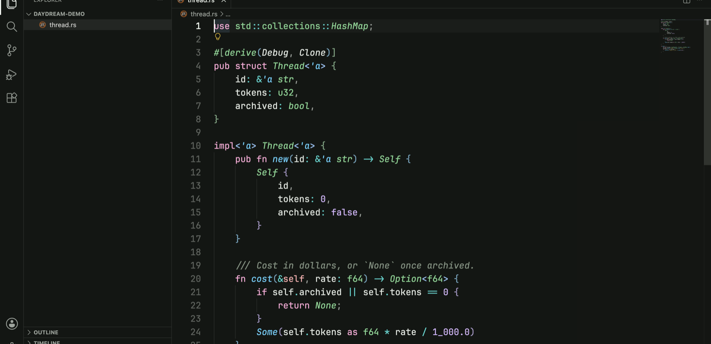

  

<h1 align="center">Daydream</h1>

<em>Faintly green, pleasantly elsewhere.</em>

A calm, green-tinted theme for VS Code, VSCodium, Cursor and other VS Code-compatible editors, with dark and light variants.

## Install

- **VS Code:** install [Daydream from the VS Code Marketplace](https://marketplace.visualstudio.com/items?itemName=SkyfallSoftworks.daydream).
- **VSCodium, Cursor, Windsurf and other Open VSX editors:** install [Daydream from Open VSX](https://open-vsx.org/extension/skyfall/daydream).

Then run **Preferences: Color Theme** and pick **Daydream Dark** or **Daydream Light**.

## Credits

- The interface, diff and terminal colours come from **Daydream**, the default theme in [Amp](https://ampcode.com). This is an unofficial port and is not affiliated with or endorsed by Amp.
- The token scopes and font styles are adapted from [Catppuccin for VS Code](https://github.com/catppuccin/vscode) (MIT).

## License

[MIT](LICENSE)
